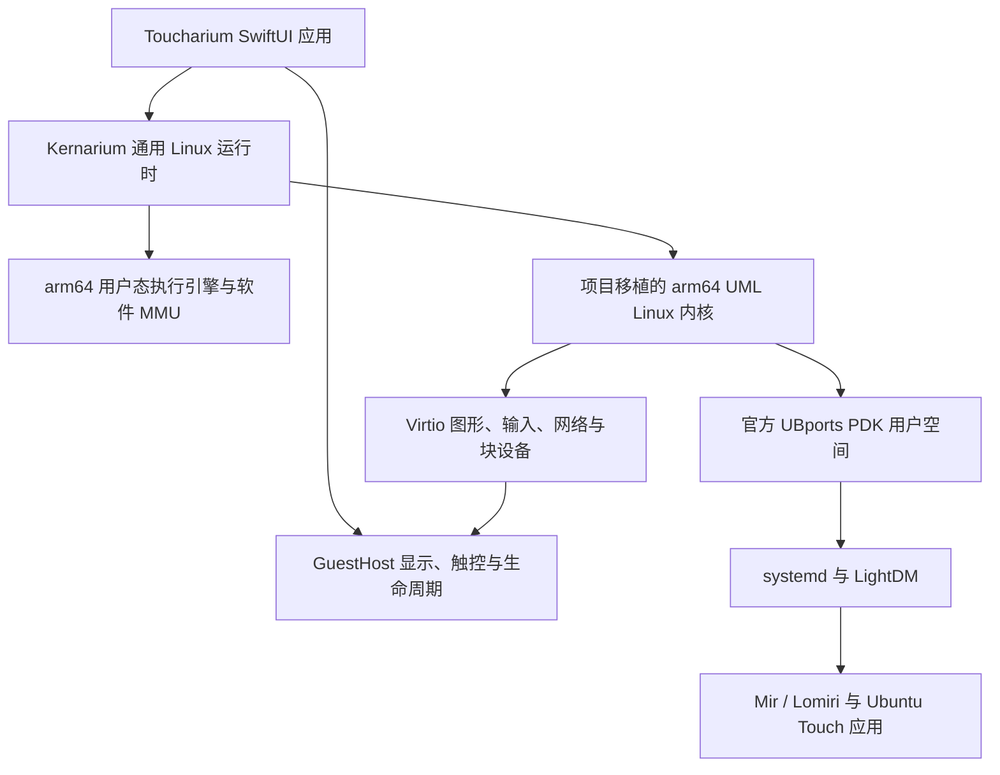
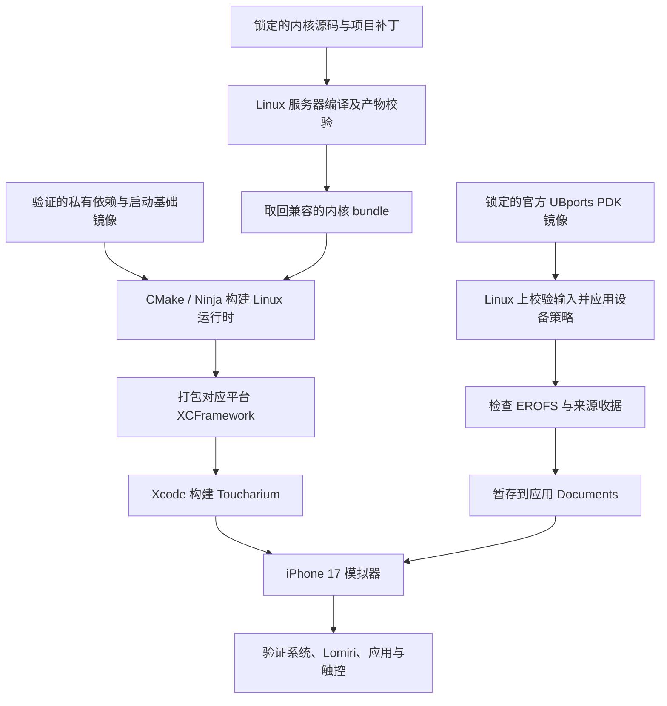

# Ubuntu Touch / Toucharium 项目

目标是在独立的 iOS 应用内运行官方 Ubuntu Touch 用户空间、Lomiri 界面和应用，复用 Andarium / Kernarium 的进程内 Linux 执行、虚拟设备与 GuestHost 显示输入机制。运行验证统一使用当前 Mac 上的 iPhone 17 模拟器。

工程位于 [`Toucharium/`](Toucharium/README.md)，镜像生产入口位于 [`tools/rootfs/ubuntu-touch/`](tools/rootfs/ubuntu-touch/README.md)。独立应用共享本仓库运行时和宿主组件，继续遵守其许可证与依赖边界。

## 架构

采用官方 mainline PDK 用户空间适配虚拟设备，不依赖某款 Android 实体设备的 Halium 厂商层。iOS 模拟器使用独立的软件渲染产物。

## 构建与部署

内核、系统镜像和应用各有独立的构建校验。安装成功、内核启动、图形会话可用和应用可操作必须分别取得运行证据。

## 验收范围

- 输入来源锁定，内核与宿主 ABI、4 KiB 客体页配置一致。
- 官方 Ubuntu Touch 系统启动；进程、文件系统、虚拟网络和 D-Bus 服务正常。
- Mir / Lomiri 持续显示，触控与键盘可操作，至少一个 Ubuntu Touch 应用可运行。
- 用户数据能在停止与重新启动后保留，应用更新不覆盖用户数据。
- 在 iPhone 17 模拟器完成冷启动、交互、暂停恢复、停止与重启验证。

目前已建立独立 Xcode 工程与官方 PDK 镜像派生工具；系统启动、图形交互与持久化尚未完成验收。不能以普通 Ubuntu 桌面或应用外壳替代 Ubuntu Touch 客体验收。
